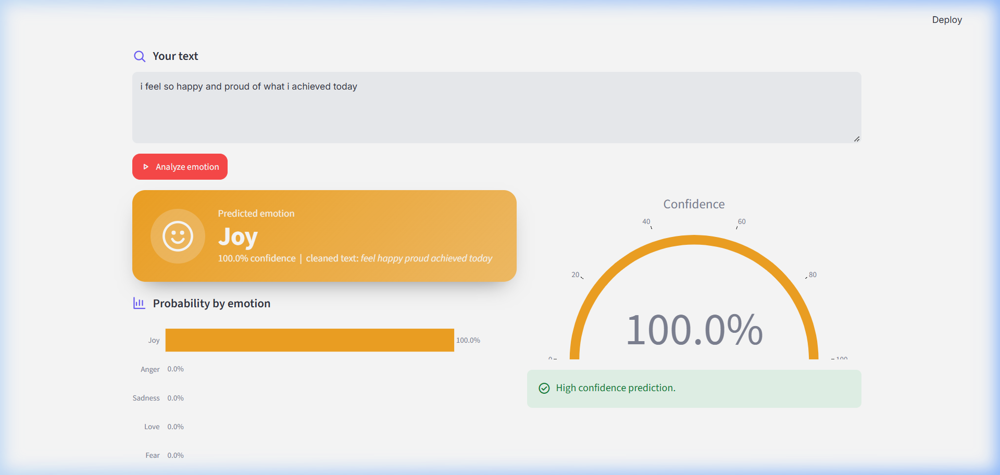
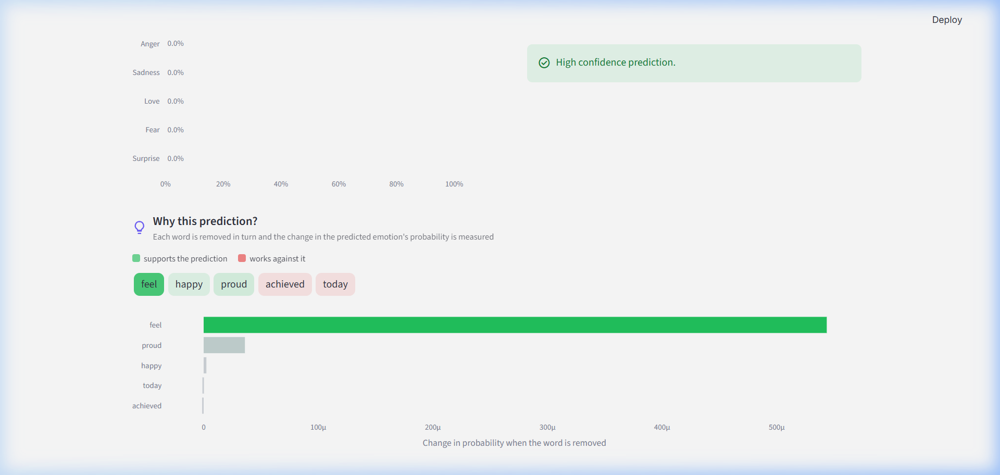
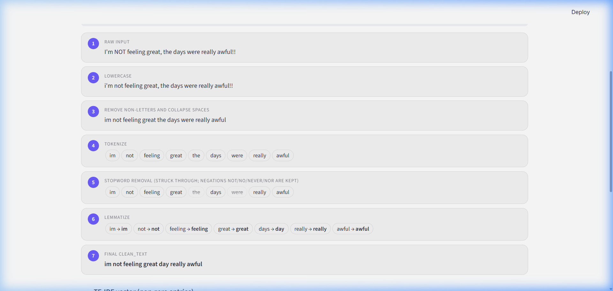
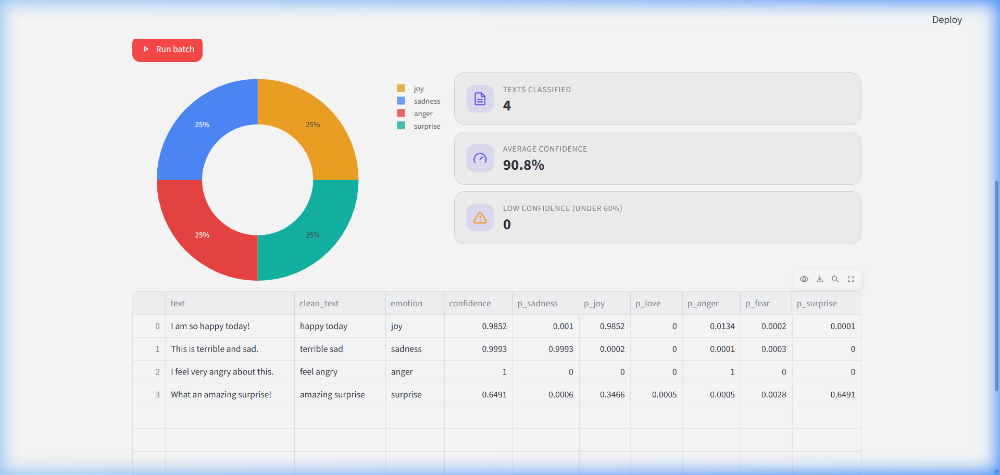
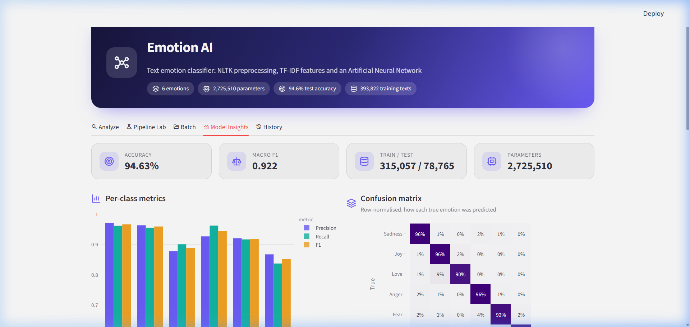
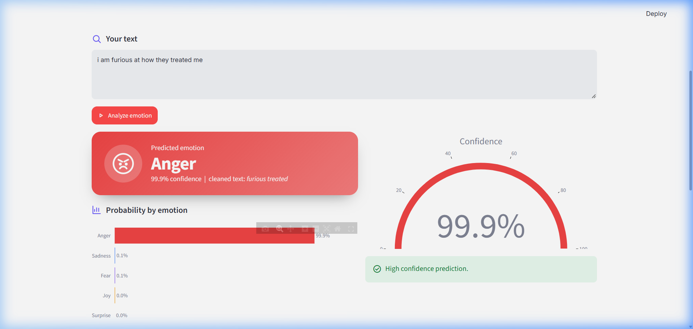
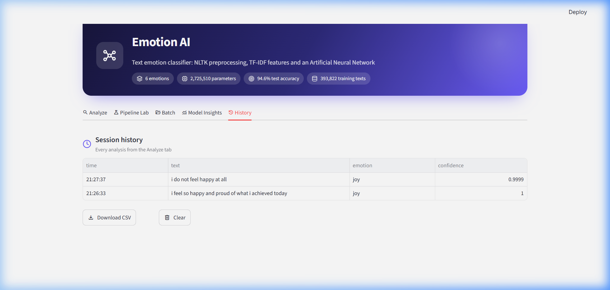
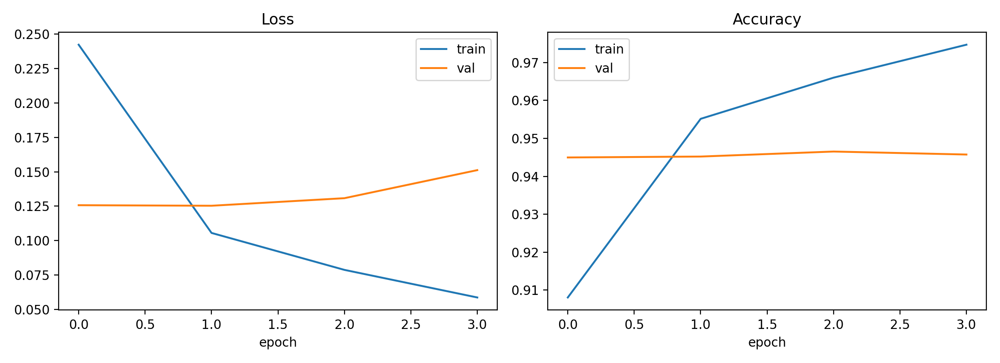

# 🧠 Emotion Detection System & Interactive AI Dashboard

[](https://www.python.org/)
[](https://www.tensorflow.org/)
[](https://streamlit.io/)
[](https://scikit-learn.org/)
[](https://www.nltk.org/)
[](#-model-performance)
[](LICENSE)

An end-to-end Deep Learning system that classifies text into 6 core human emotions (**Sadness**, **Joy**, **Love**, **Anger**, **Fear**, **Surprise**). Built with an Artificial Neural Network (ANN) trained on **~400,000 text samples**, featuring custom NLP preprocessing, TF-IDF n-gram vectorization, word attribution explainability, and an interactive **Streamlit GUI**.

---

## 📌 Table of Contents
- [Key Features](#-key-features)
- [Screenshots & UI Showcase](#-screenshots--ui-showcase)
- [System Architecture & Pipeline](#-system-architecture--pipeline)
- [Model Performance](#-model-performance)
- [Project Structure](#-project-structure)
- [Installation & Setup](#-installation--setup)
- [Usage Guide](#-usage-guide)
- [Tech Stack](#-tech-stack)

---

## ✨ Key Features

- **🎯 Real-Time Emotion Classification**:
  Predicts multi-class probabilities across 6 emotional states with an interactive confidence gauge and distribution charts.
- **💡 Word-Level Attribution (Explainability)**:
  Breaks down the input text word-by-word to reveal which tokens drive the model's prediction and the magnitude of their influence.
- **🔬 Interactive NLP Pipeline Lab**:
  Visualizes each text transformation stage in real time:
  `Raw Text` ➔ `Lowercase` ➔ `Sanitization` ➔ `Tokenization` ➔ `Stopword Filtering (negation-preserving)` ➔ `Lemmatization` ➔ `TF-IDF Vectorization`.
- **📂 Batch Classification**:
  Classify multiple entries at once using pre-set prompts or upload your own CSV dataset with real-time exportable predictions.
- **📊 Model Diagnostics & Insights**:
  Interactive confusion matrix heatmap, per-class precision/recall/F1 breakdowns, class support distributions, and training/validation loss & accuracy curves.
- **🕒 Session History Tracking**:
  Keeps a chronological log of all predictions during your session for easy auditing and inspection.

---

## 📸 Screenshots & UI Showcase

| Single Text Emotion Analysis | Word Attribution & Explainability |
| :---: | :---: |
|  |  |

| NLP Pipeline Lab | Batch Classification |
| :---: | :---: |
|  |  |

| Confusion Matrix & Model Insights | Anger Emotion & Explainability |
| :---: | :---: |
|  |  |

| Session History Log | Training & Validation Curves |
| :---: | :---: |
|  |  |

---

## 🏗️ System Architecture & Pipeline

```text
Input Text
    │
    ▼
[ Preprocessing & Tokenization ]
    ├─ Lowercase & non-alphabetic filtering
    ├─ Word tokenization (NLTK)
    ├─ Stopwords removal (Preserves negations: 'not', 'no', 'never', 'nor')
    └─ WordNet Lemmatization
    │
    ▼
[ TF-IDF Vectorizer ]
    ├─ max_features: 5,000
    └─ ngram_range: (1, 2) [Unigrams & Bigrams]
    │
    ▼
[ Deep Neural Network (ANN) ]
    ├─ Dense (512 units, ReLU) + Dropout (0.4)
    ├─ Dense (256 units, ReLU) + Dropout (0.3)
    ├─ Dense (128 units, ReLU)
    └─ Dense (6 units, Softmax)
    │
    ▼
[ Output & Interpretation ]
    ├─ Predicted Class & Confidence Score
    ├─ Probability Distribution across 6 emotions
    └─ Word-by-word attribution scoring
```

---

## 📊 Model Performance

Trained and evaluated on **393,822** deduplicated samples from the [DAIR-AI Emotion dataset](https://huggingface.co/datasets/dair-ai/emotion) with an 80/20 train/test stratified split.

### Overall Metrics
- **Test Accuracy**: `94.63%`
- **Macro Average F1-Score**: `0.922`
- **Weighted Average F1-Score**: `0.946`

### Per-Class Classification Report
| Emotion | Precision | Recall | F1-Score | Support |
| :--- | :---: | :---: | :---: | :---: |
| **Sadness** | 0.971 | 0.962 | **0.967** | 23,701 |
| **Joy** | 0.963 | 0.956 | **0.960** | 27,021 |
| **Love** | 0.878 | 0.901 | **0.889** | 5,879 |
| **Anger** | 0.927 | 0.962 | **0.944** | 10,941 |
| **Fear** | 0.921 | 0.917 | **0.919** | 8,731 |
| **Surprise** | 0.867 | 0.837 | **0.852** | 2,492 |

---

## 📁 Project Structure

```plaintext
Emotion_detection_system/
├── artifacts/                  # Trained models and evaluation metrics
│   ├── metrics.json            # Model performance and confusion matrix
│   ├── model.keras             # Trained Keras Sequential model (~31 MB)
│   └── tfidf.pkl               # Fitted TF-IDF vectorizer
├── screenshots/                # UI screenshots and performance curves
│   ├── 01_emotion_prediction_output.png
│   ├── 02_word_attribution_explainability.png
│   ├── 03_nlp_pipeline_lab_steps.png
│   ├── 04_batch_classification_results.png
│   ├── 05_model_insights_confusion_matrix.png
│   ├── 06_session_history_log.png
│   ├── 07_anger_emotion_prediction.png
│   ├── confusion_matrix.png
│   └── curves.png
├── .gitignore                  # Excludes PPT, PDF, checkpoints, and cache
├── AI_OEP(main_file).ipynb     # Complete Jupyter Notebook for EDA & training
├── app.py                      # Interactive Streamlit Web Application
├── backend.py                  # Prediction, pipeline inspection & explainability engine
├── requirements.txt            # Python dependencies
├── train_save.py               # Standalone training script for artifacts generation
├── LICENSE                     # MIT License
└── README.md                   # Project documentation
```

---

## 🚀 Installation & Setup

### 1. Clone the Repository
```bash
git clone https://github.com/MeetTailor-Data/Emotion_detection_system.git
cd Emotion_detection_system
```

### 2. Create and Activate a Virtual Environment
```bash
# Windows
python -m venv venv
venv\Scripts\activate

# macOS / Linux
python3 -m venv venv
source venv/bin/activate
```

### 3. Install Dependencies
```bash
pip install -r requirements.txt
```

---

## 💻 Usage Guide

### Option A: Launch the Streamlit Web Application
The repository comes pre-packaged with trained model weights in `artifacts/`, allowing immediate launch without retraining:
```bash
streamlit run app.py
```
Open your browser at `http://localhost:8501`.

### Option B: Retrain the Model from Scratch
If you wish to re-train the model and regenerate `artifacts/`:
```bash
python train_save.py
```
*Note: Retraining takes approximately 5–7 minutes depending on hardware.*

### Option C: Run the Jupyter Notebook
For exploratory data analysis, visualizations, and step-by-step experimentation:
```bash
jupyter notebook "AI_OEP(main_file).ipynb"
```

---

## 🛠️ Tech Stack

- **Core Language**: Python 3.10+
- **Deep Learning**: TensorFlow / Keras (Artificial Neural Networks)
- **Natural Language Processing**: NLTK (Tokenization, Lemmatization, Stopwords)
- **Feature Extraction & Metrics**: Scikit-Learn (TF-IDF, Classification Report, Confusion Matrix)
- **Interactive UI**: Streamlit & Plotly (Custom SVG icons, interactive charts & gauges)
- **Data Manipulation**: Pandas, NumPy, PyArrow

---

## 📄 License
This project is open-source and available under the [MIT License](LICENSE).
